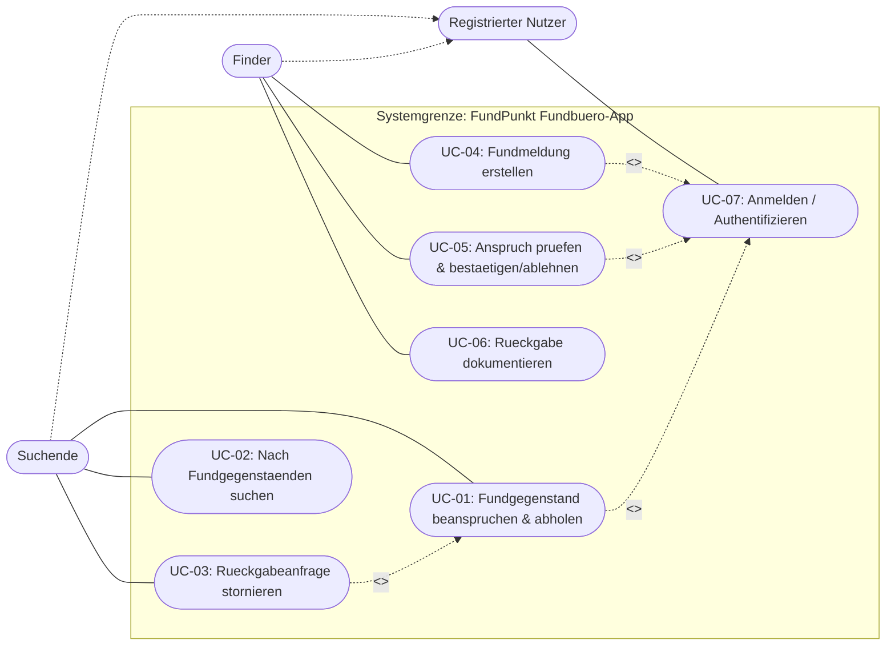

# Übungsblatt 1: Anforderungserhebung – Fallstudie „FundPunkt“ (Fundbüro-App)

## Aufgabe 1 – Wahl der Fallstudie

**Gewählte Fallstudie:** Fundbüro-App (**FundPunkt**)

**Kurzbeschreibung:**
FundPunkt ist eine digitale Fundbüro-Anwendung (z. B. für einen Hochschulcampus oder eine Gemeinde), mit der gefundene und verlorene Gegenstände schnell gemeldet, gezielt durchsucht und nach erfolgreicher Eigentumsprüfung sicher an ihre Besitzer zurückgegeben werden können.

---

## Aufgabe 3 – Personas

### Persona 1: Anna Berger (Suchende / Verliererin)
- **Demografische Daten:** 23 Jahre alt, Bachelorstudentin (Wirtschaftsingenieurwesen) an der Hochschule München, pendelt täglich mit der U-Bahn zum Campus Lothstraße.
- **Bedürfnisse:** Möchte sofort prüfen können, ob ihr verlorener Rucksack oder Schlüsselbund gefunden wurde, ohne telefonisch oder persönlich bei mehreren Stellen nachfragen zu müssen.
- **Probleme und Herausforderungen:** Weiß oft nicht genau, wo sie einen Gegenstand verloren hat, und hat im stressigen Uni-Alltag wenig Zeit, zu den knappen Öffnungszeiten am Infopoint vorbeizugehen.
- **Verhalten in der Vergangenheit:** Hat bisher Aushänge am Schwarzen Brett gelesen, in Studi-Chatgruppen gefragt oder tagelang gewartet, bis sie jemanden telefonisch erreicht hat.
- **Ziele:** Schnell nach verlorenen Gegenständen suchen, ihren Eigentumsanspruch unkompliziert nachweisen und einen klaren Abholtermin vereinbaren.
- **Qualitätswahrnehmung:** Erwartet eine schnelle, mobil gut bedienbare Suche und zeitnahe Rückmeldungen zum Status ihrer Anfrage.

### Persona 2: Markus Lindner (Finder)
- **Demografische Daten:** 41 Jahre alt, Laboringenieur an der Hochschule München, findet regelmäßig liegengebliebene Gegenstände (z. B. Trinkflaschen, Ladegeräte, Rucksäcke) in Hörsälen und auf dem Campus.
- **Bedürfnisse:** Möchte gefundene Gegenstände mit minimalem Aufwand erfassen und sicherstellen, dass sie wirklich an die rechtmäßige Besitzerin übergeben werden.
- **Probleme und Herausforderungen:** Hat keine Zeit für lange Papierformulare und möchte seine private Telefonnummer oder Wohnadresse nicht öffentlich teilen.
- **Verhalten in der Vergangenheit:** Hat Fundstücke meist einfach beim Hausmeister abgegeben, ohne zu erfahren, ob sie je abgeholt wurden.
- **Ziele:** Fundstücke strukturiert mit Fundort, Datum und einem verdeckten Sicherheitsmerkmal erfassen, eingehende Ansprüche prüfen und die Übergabe sauber dokumentieren.
- **Qualitätswahrnehmung:** Legt großen Wert auf Datenschutz, Missbrauchsschutz (keine Herausgabe an Unbefugte) und eine eindeutige Statusverwaltung.

---

## Aufgabe 4 – Szenario

### Narratives Szenario: „Verlorenen Rucksack wiederfinden und abholen“

Nach einer langen Vorlesung im R-Bau bemerkt Anna erst in der U-Bahn, dass sie ihren dunkelblauen Rucksack im Hörsaal vergessen hat. Da der Raum inzwischen abgeschlossen ist, öffnet sie am nächsten Morgen die Web-App **FundPunkt** und meldet sich mit ihrem Benutzerkonto an.

Bereits am Vorabend hat Markus Lindner den vergessenen Rucksack beim Abschließen des Hörsaals gefunden. Er meldet sich in **FundPunkt** an und erstellt eine neue Fundmeldung: Titel „Blauer Rucksack“, Kategorie „Taschen“, Fundort „R-Bau Hörsaal R1.046“, Funddatum „2026-11-23“. Zusätzlich trägt er als nicht-öffentliches Sicherheitsmerkmal ein: „Roter Schlüsselanhänger mit HM-Logo in der Vordertasche“. Das System speichert die Fundmeldung im Status *Gemeldet*.

Am nächsten Morgen gibt Anna in der Suchleiste „Rucksack“ ein und filtert nach der Kategorie „Taschen“. Das System zeigt ihr Markus' Fundmeldung an (ohne das verdeckte Sicherheitsmerkmal). Anna erkennt ihren Rucksack, klickt auf „Anspruch melden“ und gibt als Eigentumsnachweis „Roter Schlüsselanhänger mit HM-Logo in der Vordertasche“ ein. Das System legt eine Rückgabeanfrage an und setzt die Fundmeldung auf *Beansprucht*.

Markus erhält eine Benachrichtigung, vergleicht Annas Angabe mit seinem hinterlegten Sicherheitsmerkmal und bestätigt die Anfrage. Das System ändert den Status der Fundmeldung auf *Abholbereit* und schaltet für Anna den vereinbarten Übergabeort (Labor R2.012) frei. Am Nachmittag holt Anna den Rucksack ab, Markus bestätigt die Übergabe im System, und die Fundmeldung wechselt in den Endstatus *Zurückgegeben*.

### Zusammenfassung des Szenarios
- **Name des Szenarios:** Verlorenen Rucksack wiederfinden und abholen
- **Beteiligte Persona:** Anna Berger (Suchende), Markus Lindner (Finder)
- **Übergeordnetes Ziel:** Einen verlorenen Gegenstand schnell auffinden, die Eigentümerschaft eindeutig verifizieren und die Rückgabe geordnet abwickeln.
- **Was zur Zielerreichung nötig ist:** Benutzerkonto, Fundmeldung mit verdecktem Sicherheitsmerkmal, Such- und Filterfunktion, Rückgabeanfrage mit Bestätigungsprozess und Übergabedokumentation.
- **Problem mit dem bestehenden System:** Papierlisten und unkoordinierte Chatgruppen sind unübersichtlich; Finder wissen nicht, wie sie echte Besitzer von Unbefugten unterscheiden können.
- **Mögliche Problemlösungen:** Zentrale Fundbüro-App mit strukturierter Suche, geschütztem Eigentumsnachweis und klarem Lebenszyklus jeder Fundmeldung.

---

## Aufgabe 5 – User Stories

1. **US-01 (Fund melden):** Als Finder möchte ich einen gefundenen Gegenstand mit Titel, Kategorie, Fundort, Funddatum und einem verdeckten Sicherheitsmerkmal erfassen können, damit der rechtmäßige Besitzer ihn wiederfinden kann.
2. **US-02 (Suchen):** Als Suchende möchte ich nach gefundenen Gegenständen anhand von Suchbegriffen und Kategorien suchen können, damit ich schnell herausfinde, ob mein verlorener Gegenstand abgegeben wurde.
3. **US-03 (Anspruch melden):** Als Suchende möchte ich zu einer passenden Fundmeldung eine Rückgabeanfrage mit meinem Eigentumsnachweis stellen können, damit ich meinen Gegenstand beanspruchen kann.
4. **US-04 (Anspruch prüfen):** Als Finder möchte ich eingehende Rückgabeanfragen anhand des angegebenen Eigentumsnachweises bestätigen oder ablehnen können, damit der Gegenstand nur an die rechtmäßige Person übergeben wird.
5. **US-05 (Anfrage stornieren):** Als Suchende möchte ich eine noch nicht abgeschlossene Rückgabeanfrage stornieren können, damit die Fundmeldung bei einem Irrtum wieder für andere Suchende freigegeben wird.
6. **US-06 (Rückgabe dokumentieren):** Als Finder möchte ich die erfolgte Übergabe des Gegenstands im System bestätigen können, damit die Fundmeldung abgeschlossen ist und nicht mehr in der öffentlichen Suche erscheint.

---

## Aufgabe 6 – Anwendungsfalldiagramm (Use-Case-Diagramm)

---

## Aufgabe 7 – Strukturierter Anwendungsfall

- **Anwendungsfall-Name:** UC-01 – Fundgegenstand beanspruchen und zurückgeben
- **Akteur(e):** Suchende (Primärakteur, z. B. Anna Berger), Finder (Sekundärakteur, z. B. Markus Lindner)
- **Ziel:** Eine Suchende beansprucht einen gefundenen Gegenstand durch einen Eigentumsnachweis und erhält ihn nach Bestätigung durch den Finder zurück.
- **Vorbedingungen:**
  1. Suchende und Finder sind im System registriert und angemeldet.
  2. Der gesuchte Gegenstand wurde bereits als Fundmeldung erfasst und befindet sich im Status *Gemeldet*.
- **Nachbedingung:**
  - *Erfolgsfall:* Die Rückgabeanfrage ist *Abgeschlossen*, die Fundmeldung befindet sich im Status *Zurückgegeben* und erscheint nicht mehr in der offenen Suche.
  - *Fehler-/Abbruchfall:* Die Rückgabeanfrage wurde *Abgelehnt* oder *Storniert*, und die Fundmeldung befindet sich wieder im Status *Gemeldet*.
- **Hauptablauf:**
  1. Die Suchende sucht nach einem verlorenen Gegenstand und öffnet eine passende Fundmeldung.
  2. Die Suchende beschreibt ein eindeutiges Erkennungsmerkmal (Eigentumsnachweis) und sendet eine Rückgabeanfrage ab.
  3. Das System prüft, ob die Fundmeldung noch im Status *Gemeldet* ist, legt die Rückgabeanfrage im Status *Angefragt* an und setzt die Fundmeldung auf *Beansprucht*.
  4. Der Finder prüft den eingereichten Eigentumsnachweis gegen das verdeckte Sicherheitsmerkmal und bestätigt die Anfrage.
  5. Das System setzt die Rückgabeanfrage auf *Bestätigt*, die Fundmeldung auf *Abholbereit* und gibt die Übergabedetails für die Suchende frei.
  6. Bei der persönlichen Abholung bestätigt der Finder die Übergabe im System.
  7. Das System setzt die Rückgabeanfrage auf *Abgeschlossen* und die Fundmeldung auf *Zurückgegeben*.
- **Alternativer Ablauf:**
  - *A1 (Ablehnung in Schritt 4):* Der Eigentumsnachweis stimmt nicht überein. Der Finder lehnt die Anfrage ab. Das System setzt die Anfrage auf *Abgelehnt* und die Fundmeldung wieder auf *Gemeldet*.
  - *A2 (Stornierung vor Schritt 6):* Die Suchende bemerkt eine Verwechslung und storniert ihre Anfrage. Das System setzt die Anfrage auf *Storniert* und die Fundmeldung wieder auf *Gemeldet*.
- **Ausnahmen:**
  - *E1 (Leerer Eigentumsnachweis in Schritt 2):* Die Suchende gibt keinen Eigentumsnachweis an. Das System verweigert das Absenden und zeigt eine Fehlermeldung an.
  - *E2 (Fundmeldung bereits beansprucht in Schritt 3):* Ein anderer Nutzer hat den Gegenstand bereits beansprucht. Das System bricht den Vorgang mit einem Hinweis ab.
- **Beteiligte Systeme:** FundPunkt Web-Anwendung, Benachrichtigungsdienst (E-Mail).
