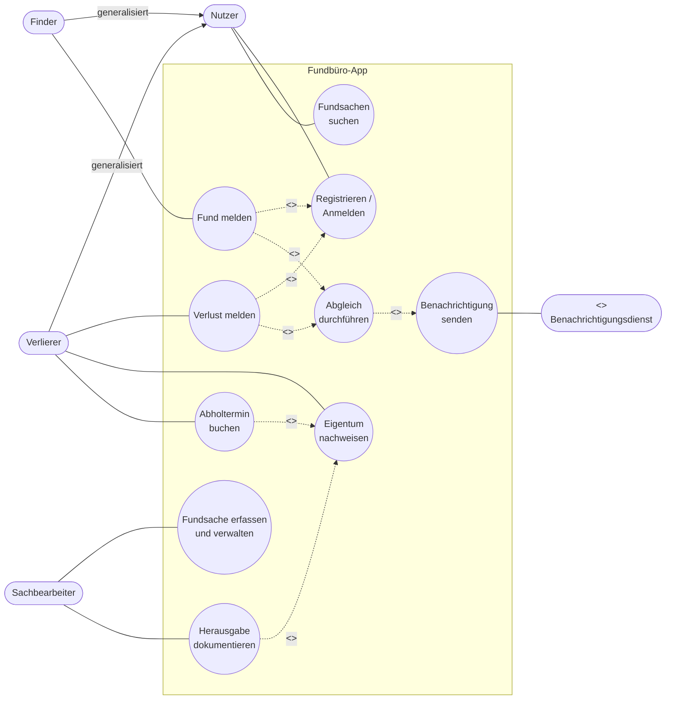

# Übungsblatt 1: Grundlagen & Anforderungserhebung – Fundbüro-App

**Fallstudie:** Digitale Fundbüro-App zum Melden von Verlusten und Funden, automatischem Abgleich, Eigentumsprüfung, Terminvergabe und dokumentierter Herausgabe.

---

## Aufgabe 3 - Erstellen Sie Personas für die wichtigsten Nutzergruppen Ihres Systems

### Persona 1: Lena Hoffmann, die Verliererin

| Aspekt | Beschreibung |
|---|---|
| **Demografie** | 22 Jahre, Studentin (Informatik, 4. Semester), wohnt in einer WG, pendelt täglich mit Bus und Bahn. Sehr smartphone-affin, nutzt fast nur mobile Apps. |
| **Bedürfnisse** | Schnell und unkompliziert melden, was sie verloren hat, und möglichst schnell Rückmeldung erhalten. Sie will nicht zu Öffnungszeiten ins Amt gehen. |
| **Probleme und Herausforderungen** | Sie weiß nicht, wo sie ihren Rucksack verloren hat (Bus, Bahn oder Uni). Sie kennt die zuständigen Stellen nicht (Verkehrsbetrieb, Uni, städtisches Fundbüro). Sie hat tagsüber Vorlesungen und kann nicht zu Öffnungszeiten vorbeikommen. |
| **Verhalten in der Vergangenheit** | Sie hat schon zweimal Gegenstände verloren (Kopfhörer, Schlüssel). Sie hat im Netz gesucht, mehrere Hotlines angerufen und dort nie jemanden erreicht. Sie hat die Sachen aufgegeben. |
| **Ziele** | Verlorene Gegenstände zurückbekommen, besonders wertvolle (Laptop, Ausweis). Wenig Zeitaufwand. Gleich eine Benachrichtigung erhalten, wenn etwas Passendes gefunden wird. |
| **Qualitätswahrnehmung** | Erwartet eine intuitive Bedienung, kurze Formulare (max. 2 Minuten), Foto-Upload, Push-Benachrichtigungen und Ladezeiten unter 2 Sekunden. Eine App, die abstürzt oder viele Pflichtfelder hat, deinstalliert sie sofort. |

### Persona 2: Klaus Brandt, der Sachbearbeiter im Fundbüro

| Aspekt | Beschreibung |
|---|---|
| **Demografie** | 58 Jahre, seit 20 Jahren Verwaltungsangestellter im städtischen Fundbüro. Gute Büro-Software-Kenntnisse, aber wenig Begeisterung für neue Technik. |
| **Bedürfnisse** | Fundsachen schnell erfassen, übersichtlich verwalten und rechtssicher herausgeben. Er braucht eine klare Oberfläche ohne Schnickschnack. |
| **Probleme und Herausforderungen** | Fundsachen werden bisher auf Papier und in einer veralteten Excel-Liste geführt. Es gibt viele telefonische Nachfragen. Er muss Eigentumsnachweise prüfen und gesetzliche Aufbewahrungsfristen (6 Monate) einhalten. Das Lager ist voll. |
| **Verhalten in der Vergangenheit** | Er hat bisher alles manuell dokumentiert und einen neuen Gegenstand erst nach Feierabend ins System eingetragen. Neue Software hat er bisher skeptisch ausprobiert. Wenn sie umständlich war, ist er zur Papierlösung zurückgekehrt. |
| **Ziele** | Weniger Aufwand pro Fundsache, weniger Rückfragen am Telefon, Fundsachen schneller an Besitzer zurückgeben und das Lager entlasten. |
| **Qualitätswahrnehmung** | Zuverlässigkeit und Nachvollziehbarkeit sind ihm am wichtigsten (Protokollierung jeder Herausgabe). Große Schrift, klare Menüs und Tastaturbedienung sind ihm wichtig. |

### Persona 3: Tom Weber, der ehrliche Finder

| Aspekt | Beschreibung |
|---|---|
| **Demografie** | 41 Jahre, Vertriebsmitarbeiter, Vater von zwei Kindern, fährt mit der S-Bahn zur Arbeit. Mittlere Technikaffinität. |
| **Bedürfnisse** | Einen gefundenen Gegenstand schnell loswerden, ohne Umwege und ohne persönliche Verpflichtungen. |
| **Probleme und Herausforderungen** | Er weiß nicht, wo er Fundsachen abgeben soll. Er hat Angst, dass ihm Ärger oder Aufwand entstehen (Formulare, Zeugenaussagen). Er hat wenig Zeit. |
| **Verhalten in der Vergangenheit** | Er hat schon einmal einen Geldbeutel beim Schaffner abgegeben und nie erfahren, ob der Besitzer ihn zurückbekam. |
| **Ziele** | Dem Besitzer helfen, dabei möglichst wenig Aufwand haben. Er möchte erfahren, ob der Gegenstand zurückgegeben wurde. |
| **Qualitätswahrnehmung** | Meldung in unter einer Minute, Standort per GPS automatisch erfasst, klare Anweisung, wohin er den Gegenstand bringen soll. |

---

## Aufgabe 4 - Schreiben Sie ein Szenario, in der die Persona Ihre Anwendung ausführt

### Szenario: „Lena findet ihren verlorenen Rucksack wieder“

Es ist Montagabend, 18:30 Uhr. Lena sitzt in ihrer WG-Küche und greift nach ihrem Rucksack, um ihren Laptop auszupacken. Da bemerkt sie, dass der Rucksack fehlt. Sie hat ihn vermutlich in der S-Bahn auf der Heimfahrt liegen lassen. Darin sind ihr Laptop, ihr Studentenausweis und ein Ladekabel.

Panik kommt auf. Sie erinnert sich an die Fundbüro-App, die sie gestern installiert hat. Sie öffnet die App und tippt auf „Verlust melden“. Als Kategorie wählt sie „Tasche/Rucksack“. Sie gibt die Beschreibung ein: schwarzer Rucksack, Marke „Eastpak“, ein roter Anhänger am Reißverschluss, Inhalt Laptop. Sie wählt den Verlustort „S-Bahn Linie S3, Richtung Innenstadt“ und das ungefähre Zeitfenster 17:30 bis 18:15 Uhr. Als Foto lädt sie ein ähnliches Bild aus ihrer Galerie hoch. Sie gibt ihre Kontaktdaten an und aktiviert Push-Benachrichtigungen. Nach etwa zwei Minuten bestätigt die App die Meldung und zeigt eine Meldenummer.

Die App zeigt sofort eine Liste ähnlicher Fundsachen. Es ist noch nichts Passendes dabei. Lena legt das Handy weg.

Um 20:10 Uhr findet Tom Weber den Rucksack in der Endhaltestelle der S-Bahn. Er öffnet die App, tippt auf „Fund melden“ und fotografiert den Rucksack. Die App erfasst seinen Standort per GPS. Er gibt an, dass er den Rucksack beim Fundbüro abgeben wird, und bekommt eine Anleitung dazu.

Das System gleicht die Fundmeldung automatisch mit offenen Verlustmeldungen ab. Es findet eine hohe Übereinstimmung mit Lenas Meldung (Kategorie, Farbe, Ort, Zeit). Um 20:11 Uhr erhält Lena eine Push-Nachricht: „Möglicher Treffer für Ihren Rucksack!“

Lena öffnet die App und sieht das Foto. Es ist ihr Rucksack mit dem roten Anhänger. Sie tippt auf „Das ist meiner“ und beantwortet eine Kontrollfrage („Welche Marke hat Ihr Laptop?“), um das Eigentum zu bestätigen. Dann wählt sie einen Abholtermin im Fundbüro am nächsten Tag um 16:00 Uhr. Die App bestätigt den Termin und erinnert sie am nächsten Morgen daran.

Am nächsten Tag zeigt Lena am Schalter ihren Ausweis und die digitale Abholbestätigung in der App. Herr Brandt scannt den QR-Code. Sein System zeigt die Fundsache samt Beschreibung und Besitzer-Anfrage. Er prüft den Ausweis, gibt den Rucksack heraus und schließt den Vorgang mit „Herausgegeben“ ab. Lena erhält eine Bestätigung. Tom erhält ebenfalls eine Nachricht: „Der Gegenstand wurde zurückgegeben. Danke für Ihre Hilfe!“

### Zusammenfassung

| Punkt | Inhalt |
|---|---|
| **Name des Szenarios** | Verlorenen Gegenstand melden, finden lassen und zurückerhalten |
| **Beteiligte Personas** | Lena Hoffmann (Verliererin), Tom Weber (Finder), Klaus Brandt (Sachbearbeiter) |
| **Übergeordnetes Ziel** | Lena bekommt ihren Rucksack schnell und sicher zurück. |
| **Was zur Zielerreichung nötig ist** | Verlustmeldung mit Beschreibung, Ort, Zeit und Foto. Fundmeldung durch den Finder. Automatischer Abgleich beider Meldungen. Benachrichtigung. Eigentumsprüfung. Terminvereinbarung. Dokumentierte Übergabe. |
| **Problem mit dem bestehenden System** | Aktuell sind Verlust- und Fundmeldungen getrennt und meist telefonisch oder auf Papier. Es gibt keinen automatischen Abgleich und keine Benachrichtigung. Die Zuständigkeiten sind unklar (Verkehrsbetrieb, Stadt, Uni). Es gibt feste Öffnungszeiten, und der Finder erfährt nichts über den Ausgang. |
| **Mögliche Problemlösungen** | Zentrale App mit einheitlicher Plattform für alle Fundstellen. Automatischer Abgleich über Kategorie, Merkmale, Ort, Zeit (optional Bildvergleich). Push-Benachrichtigung bei Treffer. Eigentumsprüfung über Kontrollfragen. Online-Terminbuchung. QR-Code für die Übergabe. Rückmeldung an den Finder. |

---

## Aufgabe 5 - Schreiben und analysieren Sie User Stories

Format: *Als [Rolle] möchte/muss ich [Funktion], damit [Nutzen].*

| Nr. | User Story |
|---|---|
| **US1** | Als **Verlierer** möchte ich einen verlorenen Gegenstand mit Beschreibung, Foto, Ort und Zeitraum melden, damit das System und das Fundbüro gezielt danach suchen können. |
| **US2** | Als **Finder** möchte ich einen gefundenen Gegenstand mit Foto und automatisch erfasstem Standort melden, damit der Besitzer ihn schnell wiederfindet und ich wenig Aufwand habe. |
| **US3** | Als **Verlierer** möchte ich automatisch benachrichtigt werden, wenn ein passender Gegenstand gefunden wurde, damit ich nicht dauernd selbst suchen muss. |
| **US4** | Als **Nutzer** möchte ich die Fundsachen nach Kategorie, Ort, Datum und Stichwort filtern und durchsuchen, damit ich schnell den passenden Gegenstand finde. |
| **US5** | Als **Verlierer** muss ich mein Eigentum über Kontrollfragen oder Merkmale nachweisen, damit Gegenstände nicht an Unbefugte herausgegeben werden. |
| **US6** | Als **Verlierer** möchte ich online einen Abholtermin im Fundbüro buchen, damit ich nicht zu den Öffnungszeiten warten muss. |
| **US7** | Als **Sachbearbeiter** möchte ich eingehende Fundsachen erfassen, mit Lagerort versehen und deren Status verwalten, damit ich den Überblick über das Lager behalte. |
| **US8** | Als **Sachbearbeiter** möchte ich eine Herausgabe per QR-Code-Scan dokumentieren, damit jede Übergabe nachvollziehbar und rechtssicher protokolliert ist. |
| **US9** | Als **Sachbearbeiter** möchte ich eine Liste der Fundsachen sehen, deren Aufbewahrungsfrist abläuft, damit ich sie fristgerecht versteigern, spenden oder entsorgen kann. |
| **US10** | Als **Finder** möchte ich benachrichtigt werden, wenn der Gegenstand zurückgegeben wurde, damit ich weiß, dass meine Hilfe erfolgreich war. |
| **US11** | Als **Nutzer** muss ich mich registrieren und anmelden, damit meine Meldungen und persönlichen Daten geschützt sind und mir zugeordnet werden. |

**Kurze Analyse:** US1 bis US3 und US5 bis US6 bilden den Kern des Systems. US5 und US8 sind sicherheits- und rechtsrelevant. US7 und US9 sind Verwaltungsfunktionen für das Fundbüro. US11 ist eine technische Voraussetzung für alle Nutzerfunktionen. Die Stories sind klein und testbar. US4 und US10 sind Kandidaten für spätere Releases.

---

## Aufgabe 6 - Anwendungsfalldiagramm

### Akteure

- **Nutzer** (generalisierter Oberakteur von Verlierer und Finder)
- **Verlierer** (Nutzer)
- **Finder** (Nutzer)
- **Sachbearbeiter** (Fundbüro)
- **Benachrichtigungsdienst** (externes System, z. B. Push-/E-Mail-Dienst)

### Beziehungen

- Verlierer und Finder erben vom Nutzer. Der Nutzer führt „Registrieren / Anmelden“ und „Fundsachen suchen“ aus.
- „Verlust melden“, „Eigentum nachweisen“ und „Abholtermin buchen“ werden vom Verlierer ausgeführt.
- „Fund melden“ wird vom Finder ausgeführt.
- „Fundsache erfassen und verwalten“ und „Herausgabe dokumentieren“ werden vom Sachbearbeiter ausgeführt.
- `<<include>>`: „Verlust melden“ und „Fund melden“ schließen „Registrieren / Anmelden“ und „Abgleich durchführen“ ein; „Abgleich durchführen“ schließt „Benachrichtigung senden“ ein; „Herausgabe dokumentieren“ schließt „Eigentum nachweisen“ ein.
- `<<extend>>`: „Abholtermin buchen“ erweitert „Eigentum nachweisen“ (optional bei erfolgreichem Nachweis).

---

## Aufgabe 7 - Anwendungsfall Detaillieren

| Aspekt | Beschreibung |
|---|---|
| **Anwendungsfall-Name** | UC-02: Verlorenen Gegenstand melden und bei Treffer zurückerhalten |
| **Akteure** | Primär: Verlierer. Sekundär: Finder, Sachbearbeiter, Benachrichtigungsdienst |
| **Ziel** | Der Verlierer meldet seinen Verlust und erhält den Gegenstand nach Treffer und Eigentumsprüfung zurück. |
| **Vorbedingungen** | Die App ist installiert. Der Verlierer ist registriert und angemeldet. Das System ist erreichbar. |
| **Nachbedingung (Erfolg)** | Die Verlustmeldung ist gespeichert und der Treffer zugeordnet. Der Gegenstand ist an den Verlierer herausgegeben. Der Status steht auf „Herausgegeben“, und die Übergabe ist protokolliert. Der Finder wurde informiert. |
| **Nachbedingung (Fehlschlag)** | Die Verlustmeldung bleibt aktiv („Offen“) und wird weiter mit neuen Funden abgeglichen. Bei Ablauf der Frist wird sie archiviert. |

### Hauptablauf

1. Der Verlierer wählt „Verlust melden“.
2. Das System zeigt das Meldeformular (Kategorie, Beschreibung, Verlustort, Zeitraum, Foto, Kontakt).
3. Der Verlierer füllt die Pflichtfelder aus und sendet das Formular ab.
4. Das System validiert die Eingaben, speichert die Meldung und vergibt eine Meldenummer.
5. Das System gleicht die Meldung mit vorhandenen Fundmeldungen ab und zeigt eine Liste ähnlicher Funde an (hier: keine Treffer).
6. Das System bestätigt die Meldung. Sie ist als „Offen“ gespeichert.
7. Der Finder meldet einen Fund. Das System gleicht automatisch ab und erkennt einen Treffer mit hoher Übereinstimmung.
8. Das System sendet über den Benachrichtigungsdienst eine Nachricht an den Verlierer.
9. Der Verlierer öffnet den Treffer und wählt „Das ist meiner“.
10. Das System stellt Kontrollfragen zu nicht öffentlichen Merkmalen.
11. Der Verlierer beantwortet die Fragen korrekt, das System bestätigt den Nachweis.
12. Das System zeigt freie Abholtermine, der Verlierer wählt einen und bestätigt.
13. Das System speichert den Termin, reserviert die Fundsache und erzeugt einen QR-Code.
14. Das System erinnert den Verlierer am Abholtag per Push-Nachricht.
15. Der Verlierer erscheint im Fundbüro. Der Sachbearbeiter scannt den QR-Code und prüft den Ausweis.
16. Der Sachbearbeiter gibt den Gegenstand heraus und bestätigt die Herausgabe im System.
17. Das System setzt den Status auf „Herausgegeben“, protokolliert die Übergabe und benachrichtigt Verlierer und Finder.

### Alternative Abläufe

- **A1 (ab Schritt 5, Treffer sofort vorhanden):** Das System zeigt direkt passende Funde. Der Verlierer wählt einen aus, weiter mit Schritt 9.
- **A2 (ab Schritt 9, Treffer passt nicht):** Der Verlierer wählt „Nicht mein Gegenstand“. Das System verwirft den Treffer für diese Meldung, die Meldung bleibt offen.
- **A3 (ab Schritt 12, Termin nicht passend):** Der Verlierer kann den Gegenstand per Postversand anfordern (sofern angeboten) oder später erneut einen Termin buchen.
- **A4 (ab Schritt 1, Foto fehlt):** Das Foto ist optional, die Meldung kann ohne Foto gesendet werden. Die Trefferquote sinkt dann.
- **A5 (ab Schritt 15, Stellvertreter):** Eine bevollmächtigte Person holt den Gegenstand ab. Das System verlangt eine digitale Vollmacht.

### Ausnahmen

- **E1 (Schritt 4, Pflichtfelder fehlen):** Das System markiert die Felder, die Meldung wird nicht gespeichert, bis die Eingabe korrigiert ist.
- **E2 (Schritt 4, kein Netz oder Serverfehler):** Das System speichert die Eingabe lokal als Entwurf und bietet an, sie später zu senden.
- **E3 (Schritt 11, Kontrollfragen falsch beantwortet):** Nach zwei Fehlversuchen wird der Zugriff gesperrt. Der Verlierer muss sich im Fundbüro persönlich ausweisen.
- **E4 (Schritt 8, Benachrichtigung nicht zustellbar):** Das System versucht es per E-Mail. Der Treffer bleibt in der App sichtbar.
- **E5 (Schritt 15, Termin nicht wahrgenommen):** Die Reservierung läuft nach 7 Tagen ab, die Fundsache ist wieder frei. Der Verlierer wird informiert und kann neu buchen.
- **E6 (Schritt 16, Eigentum unklar):** Der Sachbearbeiter verweigert die Herausgabe und vermerkt den Grund im System.
- **E7 (Fund eines Dritten mit gleichen Merkmalen):** Mehrere Verlierer beanspruchen denselben Fund. Das System markiert den Konflikt und der Sachbearbeiter entscheidet.

### Beteiligte Systeme

- Fundbüro-App (mobiles Frontend für Nutzer)
- Backend mit Datenbank (Meldungen, Fundsachen, Termine, Protokolle)
- Matching-Komponente (Abgleich, optional Bilderkennung)
- Push-/E-Mail-Benachrichtigungsdienst
- Terminverwaltung
- Verwaltungsoberfläche des Fundbüros mit QR-Scanner
- Optional: Karten-/Geodienst für Orte und Standort
