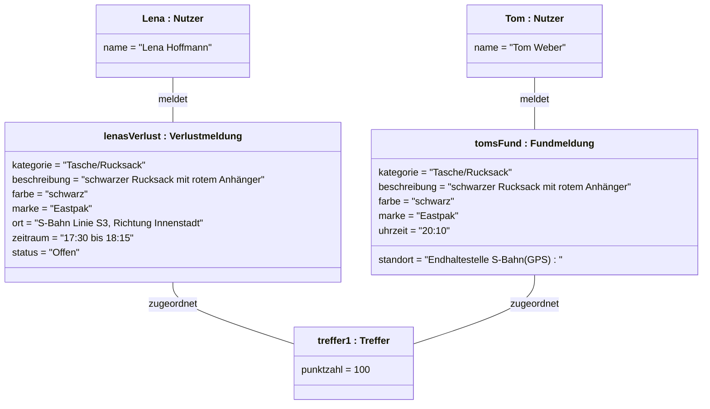
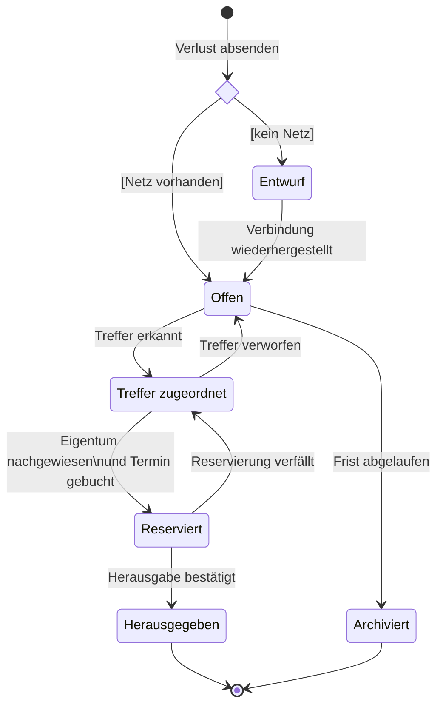

# Übungsblatt 3: Requirements-Review, Substantivanalyse & Erste UML-Modelle – Fundbüro-App

---

## Aufgabe 2 - Analysieren und verbessern Sie Ihre Anforderungen mit dem Requirements-Coach

Grundlage: Anforderungen aus `docs/01-anforderungen/uebung2-anforderungen.md`, User Stories, Personas, Szenario und Anwendungsfall UC-02. Die Fragen des Coaches wurden im Team beantwortet, die Entscheidungen sind unten dokumentiert.

### Erkenntnisse

| Nr. | Art | Betroffen | Erkenntnis |
|---|---|---|---|
| 1 | Tatsächliche Unklarheit | F-040, F-041, UC-02 | „Definierte“ bzw. „hohe Übereinstimmung“ ist nicht messbar. Es fehlen Kriterien und ein Schwellenwert, daher ist die Anforderung nicht überprüfbar. |
| 2 | Tatsächliche Unklarheit (Widerspruch) | F-070, F-090, UC-02 Schritt 15 und A5 | Der QR-Code dient zur Abholung, gleichzeitig ist eine Abholung durch Bevollmächtigte vorgesehen. Es ist nicht festgelegt, welche Kombination aus QR-Code, Ausweis und Vollmacht erforderlich ist. |
| 3 | Widerspruch zwischen Anforderungen | N-030, N-080 | Kontodaten sollen nach 30 Tagen gelöscht werden, Herausgabeprotokolle aber 3 Jahre unveränderlich abrufbar bleiben. Unklar ist, welche personenbezogenen Daten im Protokoll bleiben. |
| 4 | Offene Frage | N-080 | Die Aufbewahrungsdauer von 3 Jahren ist eine Annahme des Teams. Eine Rechtsgrundlage (Aufbewahrungspflicht oder berechtigtes Interesse nach DSGVO) ist noch nicht geprüft. |

### Entscheidungen und Änderungen

#### Entscheidung 1: Punktesystem für den Abgleich (F-040, F-041)

Die Kategorie muss übereinstimmen (Pflicht). Dazu gibt es Punkte: Ort 30, Zeit 30, Farbe 20, Marke oder Stichwort 20. Ab 70 Punkten entsteht ein Treffer mit Push-Nachricht. Zwischen 50 und 69 Punkten erscheint die Fundsache nur als „ähnliche Fundsache“, ohne Push-Nachricht.

| Betroffen | Vorher | Nachher |
|---|---|---|
| **F-040** | „… und Treffer ab einer definierten Übereinstimmung zuordnen.“ | „… und einen Treffer zuordnen, wenn die Kategorie übereinstimmt und mindestens 70 von 100 Punkten erreicht werden (Ort 30, Zeit 30, Farbe 20, Marke oder Stichwort 20). Meldungen mit 50 bis 69 Punkten werden nur als ‚ähnliche Fundsache‘ angezeigt.“ |
| **F-041** | „Nach Erkennen eines Treffers …“ | „Nach Erkennen eines Treffers (mindestens 70 Punkte) …“ |
| **Akzeptanzkriterien F-040** | Kriterium 1 ohne Punktzahl, Kriterium 4 nur Sortierung | Kriterium 1 nennt 100 Punkte für das Szenario. Kriterium 4 ergänzt den Fall mit 60 Punkten und die Sortierung nach Punkten. |

**Begründung:** Die Anforderung wird testbar. Die Zeitregel (Fund bis 24 Stunden nach Ende des Verlustzeitfensters) ist nötig, weil Tom den Rucksack erst um 20:10 Uhr meldet, das Zeitfenster aber um 18:15 Uhr endet. Das Szenario ergibt damit weiterhin 100 Punkte. Der Bereich 50 bis 69 Punkte vermeidet Fehlalarme, ohne mögliche Funde zu verbergen.

#### Entscheidung 2: QR-Code, Ausweis und Vollmacht (F-070, F-071, F-090)

Der QR-Code ist nur ein Schlüssel zum Vorgang und ersetzt keine Identitätsprüfung.

| Fall | Erforderlich |
|---|---|
| Verlierer holt selbst ab | QR-Code und Ausweis |
| Vertretung holt ab | QR-Code, eigener Ausweis der Vertretung und digitale Vollmacht |

| Betroffen | Vorher | Nachher |
|---|---|---|
| **F-070** | QR-Code wird nach Terminbuchung ausgegeben | Zusatz: Der QR-Code ersetzt nicht die Ausweisprüfung bei der Abholung. |
| **F-071** | nicht vorhanden | Neu: Der Verlierer kann eine Vertretung benennen und eine digitale Vollmacht hinterlegen. |
| **F-090** | „Nach Scan des QR-Codes …“ | „Nach Scan des QR-Codes und bestätigter Ausweisprüfung …“, bei Vertretung zusätzlich Ausweis der Vertretung und hinterlegte Vollmacht. |
| **Akzeptanzkriterien F-090** | Kriterium 4: Protokoll nicht änderbar | Die Unveränderlichkeit steht jetzt in Kriterium 1. Kriterium 4 prüft den Vertretungsfall und lehnt die Herausgabe ohne Vollmacht ab. |

**Begründung:** Klaus braucht rechtssichere Herausgaben (Persona, US8). Ein weitergegebener QR-Code allein würde das nicht gewährleisten. Die Ausweisprüfung stand schon in UC-02 Schritt 15, fehlte aber in den Anforderungen. Die Vollmacht (UC-02, A5) ist jetzt durch F-071 abgedeckt.

#### Entscheidung 3: Anonymisiertes Herausgabeprotokoll (N-030, N-080)

Das Protokoll wird bei Kontolöschung nicht gelöscht, sondern anonymisiert.

| Betroffen | Vorher | Nachher |
|---|---|---|
| **N-030** | Kein Hinweis auf Ausweisdaten | Zusatz: „Ausweisnummern werden nicht gespeichert.“ |
| **Akzeptanzkriterium N-030, Punkt 3** | „Nach Kontolöschung werden personenbezogene Daten innerhalb von 30 Tagen gelöscht …“ | Zusatz: Im Herausgabeprotokoll erscheint der Nutzer danach nur noch als „gelöschter Nutzer“, der Protokolleintrag bleibt erhalten. |
| **N-080** | „Jede Herausgabe muss unveränderlich protokolliert und 3 Jahre lang abrufbar sein.“ | Zusatz: Das Protokoll enthält nur Datum, Uhrzeit, Fund-ID, Meldenummer, Bearbeiter-ID, Ergebnis und eine interne Nutzer-ID, aber keine Namen, Kontaktdaten oder Ausweisnummern. Bei Kontolöschung wird die Verknüpfung zur Nutzer-ID entfernt. |

**Begründung:** So lassen sich Löschpflicht und Nachvollziehbarkeit vereinbaren. „Unveränderlich“ bezieht sich auf den fachlichen Inhalt. Das Entfernen des Personenbezugs ist ausdrücklich erlaubt.

#### Offene Frage 4: Aufbewahrungsdauer

Die 3 Jahre wurden zunächst beibehalten. Zu klären bleibt, auf welcher Rechtsgrundlage sie beruhen. Eine kürzere Frist wäre datenschutzfreundlicher. Dies ist mit dem Dozenten oder einer fachkundigen Stelle zu besprechen.

### Konsistenzprüfung

- **User Stories:** F-071 geht aus US6 hervor, F-040/F-041 aus US3, F-090 aus US8. Alle Änderungen haben weiterhin eine Quelle.
- **Anwendungsfall UC-02:** Schritt 15 (Ausweis) und A5 (Vertretung) stimmen jetzt mit den Anforderungen überein. Schritt 7 (hohe Übereinstimmung) entspricht jetzt dem Schwellenwert von 70 Punkten.
- **Feature 8 Terminvergabe:** umfasst jetzt F-070 und F-071.
- **Offener Hinweis:** Das Szenario nutzt die Terminbuchung, die Roadmap legt sie aber in Release 2. Das Team sollte entscheiden, ob Feature 8 in Release 1 vorgezogen wird.

---

## Aufgabe 3 - Extrahieren Sie Substantive aus Ihren Anforderungen

Grundlage: Funktionale Anforderungen F-010 bis F-110 mit Akzeptanzkriterien (`docs/01-anforderungen/uebung2-anforderungen.md`).

### Entscheidungen vorab

| Nr. | Entscheidung | Begründung |
|---|---|---|
| 1 | **Verlustmeldung und Fundmeldung** tragen beide die beschreibenden Attribute (Kategorie, Beschreibung, Foto, Farbe, Marke, Stichwort). | Der Abgleich (F-040) vergleicht genau diese Angaben beider Seiten. Die **Fundsache** ist der physische Gegenstand im Fundbüro mit Lagerort, Status und Frist. |
| 2 | **Nutzer** ist ein Objekt (mit E-Mail, Passwort, Name). Verlierer, Finder und Sachbearbeiter sind **Rollen**, die im Objektdiagramm als Link-Rollen erscheinen. | Dieselbe Person kann in verschiedenen Situationen Verlierer oder Finder sein. Vererbung ist in dieser Übung nicht vorgesehen. |
| 3 | **Herausgabe und Protokoll** sind ein Objekt. | Das Protokoll ist die Aufzeichnung der Herausgabe (F-090). |
| 4 | **Konto** wird mit Nutzer zusammengefasst. | In F-010 entstehen Konto und Nutzer gemeinsam. |

### Objekte

| Begriff | Einordnung | Begründung |
|---|---|---|
| Nutzer | Objekt | Person mit Konto (E-Mail, Passwort, Name). Es gibt viele einzelne Nutzer. |
| Verlustmeldung | Objekt | Eigenständige Meldung über einen Verlust mit eigenen Attributen und Status. |
| Fundmeldung | Objekt | Eigenständige Meldung über einen Fund durch den Finder. |
| Fundsache | Objekt | Der physische Gegenstand im Fundbüro, mit Lagerort, Status und Frist. |
| Treffer | Objekt | Entsteht beim Abgleich, verbindet eine Verlustmeldung mit einer Fundmeldung und hat eine eigene Punktzahl. |
| Abholtermin | Objekt | Vereinbarter Termin für eine Fundsache, gehört zu einem Verlierer. |
| Vollmacht | Objekt | Berechtigung einer Vertretung, eine Fundsache abzuholen, gehört zu einem Abholtermin. |
| Herausgabe (inkl. Protokoll) | Objekt | Vorgang und Aufzeichnung der Übergabe einer Fundsache mit Datum, Uhrzeit, Bearbeiter und Ergebnis. |
| Kontrollfrage | Objekt | Gehört zu einer Fundsache und hat eigene Antwort und Ergebnis. |

### Attribute

| Begriff | Einordnung | Begründung |
|---|---|---|
| E-Mail | Attribut von Nutzer | Adresse aus den Registrierungsdaten (F-010), keine Nachricht. |
| Passwort | Attribut von Nutzer | Wert, der zum Nutzer gehört. |
| Name | Attribut von Nutzer | Beschreibt den Nutzer. |
| Kategorie | Attribut von Verlustmeldung und Fundmeldung | Ein Wert wie „Rucksack“. Wird beim Abgleich verglichen. |
| Beschreibung | Attribut von Verlustmeldung und Fundmeldung | Freitext zum Gegenstand. |
| Foto | Attribut von Verlustmeldung (optional) und Fundmeldung | Bild des Gegenstands. |
| Farbe | Attribut von Verlustmeldung und Fundmeldung | Wird beim Abgleich bewertet (20 Punkte). |
| Marke | Attribut von Verlustmeldung und Fundmeldung | Wird beim Abgleich bewertet (20 Punkte). |
| Stichwort | Attribut von Verlustmeldung und Fundmeldung | Wird beim Abgleich bewertet. |
| Ort | Attribut von Verlustmeldung | Verlustort, z. B. „S-Bahn S3“. |
| Zeitraum | Attribut von Verlustmeldung | Zeitfenster des Verlusts. |
| Meldenummer | Attribut von Verlustmeldung | Identifiziert die Meldung eindeutig. |
| Datum (Verlustmeldung) | Attribut von Verlustmeldung | Zeitpunkt der Meldung. |
| Status (Verlustmeldung) | Attribut von Verlustmeldung | Zustand der Meldung, z. B. „Offen“. |
| Standort | Attribut von Fundmeldung | GPS-Position, an der der Finder den Gegenstand gefunden hat (F-030). |
| Datum und Uhrzeit (Fundmeldung) | Attribut von Fundmeldung | Zeitpunkt des Fundes, wird beim Abgleich benötigt. |
| Lagerort | Attribut von Fundsache | Wo das Fundbüro die Sache aufbewahrt. |
| Status (Fundsache) | Attribut von Fundsache | Zustand, z. B. „Eingelagert“, „Reserviert“, „Herausgegeben“. |
| Frist | Attribut von Fundsache | Ende der Aufbewahrung. |
| Merkmal | Attribut von Fundsache | Nicht öffentliche Eigenschaft, nach der die Kontrollfrage fragt (F-060). |
| Punktzahl | Attribut von Treffer | Ergebnis des Abgleichs (0 bis 100). |
| QR-Code | Attribut von Abholtermin | Wird bei der Terminbuchung erzeugt (F-070) und gilt für diesen Abholvorgang. |
| Vertretung | Attribut von Vollmacht | Es wird nur der Name der Vertretung gespeichert (F-071). |
| Datum, Uhrzeit, Bearbeiter (Herausgabe) | Attribute von Herausgabe | Pflichtangaben des Protokolls (F-090). |

### Kein Objekt im System

| Begriff | Begründung |
|---|---|
| Verlierer, Finder, Sachbearbeiter | Rollen eines Nutzers, siehe Entscheidung 2. |
| Konto | Wird mit Nutzer zusammengefasst, siehe Entscheidung 4. |
| Protokoll | Wird mit Herausgabe zusammengefasst, siehe Entscheidung 3. |
| Ausweis | Wird nur vorgezeigt und geprüft. Nach N-030 werden Ausweisnummern nicht gespeichert. |
| Rückmeldung, E-Mail (als Nachricht) | Benachrichtigungen werden versendet, aber in Release 1 nicht als eigene Objekte gespeichert. |

### Entscheidungen zu den offenen Fragen

| Frage | Entscheidung | Begründung |
|---|---|---|
| Soll eine Vertretung ein eigener Nutzer oder ein eigenes Objekt sein? | Nein. Die Vertretung bleibt ein **Attribut der Vollmacht** (Name). | F-071 verlangt nur, dass der Verlierer eine Vertretung mit Namen benennt und eine Vollmacht hinterlegt. Die Vertretung braucht kein Konto und nutzt die App nicht. Bei der Abholung wird sie über ihren Ausweis geprüft (F-090). |
| Werden Benachrichtigungen (Rückmeldung) als Objekte gespeichert? | Nein, nicht in Release 1. | Für Push-Nachricht und E-Mail-Rückfall (F-041) reicht es, die Nachricht zu versenden. Der Nachweis für das Ergebnis steckt bereits in Treffer, Status der Meldung und Herausgabe. |

---

## Aufgabe 4 - Erstellen Sie ein UML-Objektdiagramm

**Gewählter Zeitpunkt:** Montag, 20:10 Uhr – unmittelbar nachdem Tom Weber den Rucksack als Fund gemeldet und das System den Treffer mit Lenas Verlustmeldung (100 Punkte) zugeordnet hat.

**Konsistenzprüfung:** Die 5 konkreten Objekte (`Lena`, `Tom`, `lenasVerlust`, `tomsFund`, `treffer1`) und ihre Attributwerte stimmen exakt mit dem Szenario (Übung 1) und der Punkteberechnung aus `F-040` (Übung 2 & Review) überein.

---

## Aufgabe 5 - Erstellen Sie ein UML-Zustandsdiagramm

**Gewählter Objekttyp:** `Verlustmeldung`

Das Zustandsdiagramm zeigt den gesamten Lebenszyklus einer Verlustmeldung – inklusive Offline-Entwurf (`E2`), verworfenem Treffer (`A2`), abgelaufener Reservierung (`E5`), Fristablauf (Archivierung) und erfolgreicher Herausgabe.

**Unterscheidung Zustände vs. Ereignisse:** Zustände beschreiben Situationen des Objekts (`Entwurf`, `Offen`, `Treffer zugeordnet`, `Reserviert`, `Herausgegeben`, `Archiviert`), während die Beschriftungen an den Pfeilen die auslösenden Ereignisse und Bedingungen (`Verlust absenden`, `Treffer erkannt`, `Treffer verworfen`, `Eigentum nachgewiesen und Termin gebucht`, `Reservierung verfällt`, `Herausgabe bestätigt`, `Frist abgelaufen`) darstellen.
