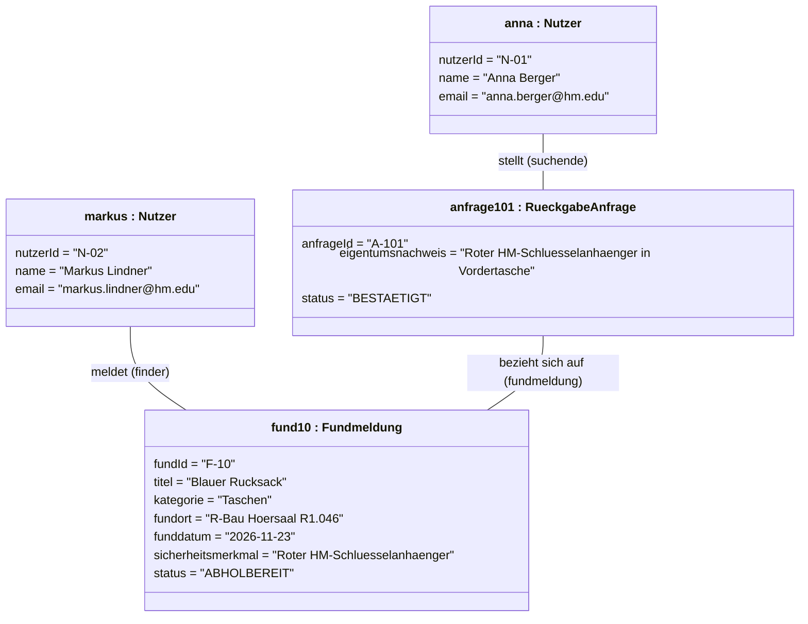
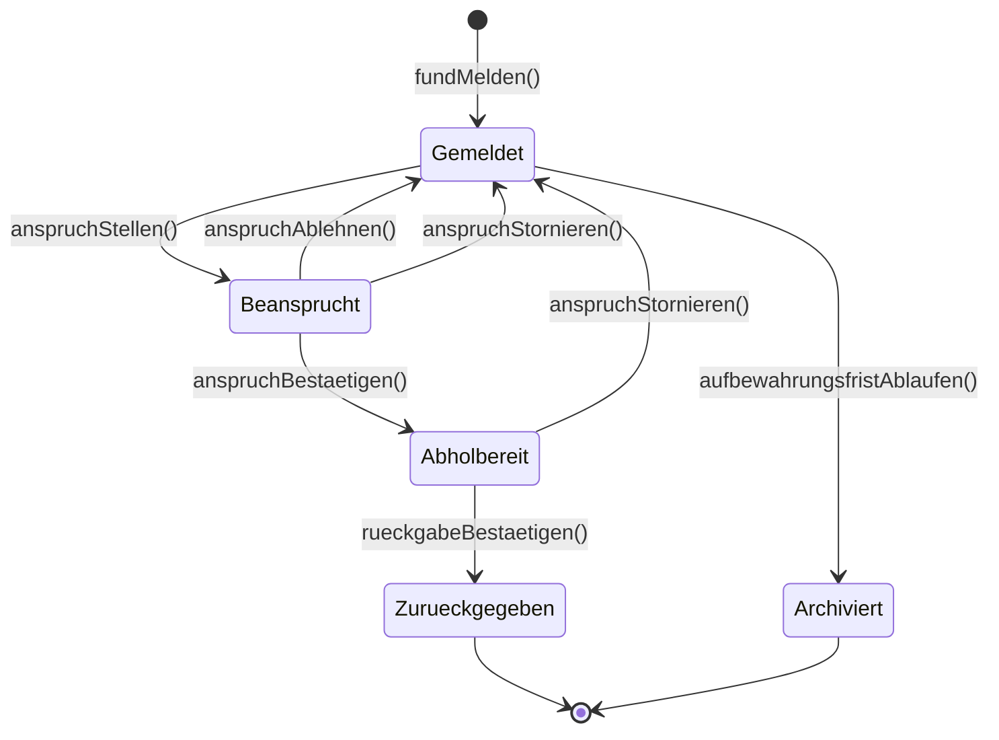

# Übungsblatt 3: Requirements-Review, Substantivanalyse & Erste UML-Modelle – „FundPunkt“

## Aufgabe 2 – Requirements-Coach Review & Verbesserungen

Im Review der Anforderungen (`docs/01-anforderungen/`) mittels `/requirements-coach` wurden folgende drei zentrale Erkenntnisse dokumentiert:

### 1. Tatsächliche Unklarheit (F-030 – Rückgabeanfrage stellen)
- **Befund:** In F-030 ist nicht festgelegt, ob der Finder selbst eine Rückgabeanfrage für seine eigene Fundmeldung stellen darf.
- **Entscheidung / Klarstellung:** Eine Selbst-Beanspruchung (Suchende = Finder) ist fachlich sinnlos und wird im System ausgeschlossen.
- **Änderung an F-030 (Version 2):**
  > *Vorher (V1):* Nach Auswahl einer offenen Fundmeldung muss das System angemeldeten Suchenden die Möglichkeit bieten, eine Rückgabeanfrage mit einem Eigentumsnachweis einzureichen.
  > *Nachher (V2):* Nach Auswahl einer offenen Fundmeldung eines anderen Nutzers muss das System angemeldeten Suchenden die Möglichkeit bieten, eine Rückgabeanfrage mit einem nicht-leeren Eigentumsnachweis einzureichen.

### 2. Offene Frage (F-040 – Status der Fundmeldung bei Ablehnung)
- **Befund:** Es war nicht explizit beschrieben, in welchen Zustand die Fundmeldung zurückkehrt, wenn der Finder eine Rückgabeanfrage wegen falschem Eigentumsnachweis ablehnt.
- **Entscheidung / Begründung:** Lehnt der Finder eine Anfrage ab, wird die Rückgabeanfrage auf *Abgelehnt* gesetzt und die Fundmeldung wechselt automatisch zurück von *Beansprucht* auf *Gemeldet*, damit die tatsächliche Besitzerin den Gegenstand weiterhin finden und beanspruchen kann.

### 3. Mögliche Verbesserung (F-010 – Aufbewahrungsfrist / Archivierung)
- **Befund:** Nicht abgeholte Gegenstände würden dauerhaft im Status *Gemeldet* verbleiben.
- **Entscheidung / Verbesserung:** Im Lebenszyklus einer Fundmeldung wird bereits der Zustand *Archiviert* vorgesehen, damit abgelaufene Fundmeldungen sauber abgeschlossen werden können (auch wenn die automatische Fristprüfung erst in Release 3 folgt).

---

## Aufgabe 3 – Substantiv-Extraktion (`/noun-extraction`)

### Extrahierte Substantive (Grundformen & Fundstellen)

| Grundform | Fundstellen (Auswahl) |
| :--- | :--- |
| Nutzer / Suchende / Finder | US-01 bis US-06, UC-01, F-010 bis F-060 |
| Fundmeldung / Fundgegenstand | US-01 bis US-06, UC-01, F-010 bis F-060 |
| Rückgabeanfrage / Anspruch | US-03, US-04, US-05, UC-01, F-030 bis F-060 |
| Titel | US-01, F-010 |
| Kategorie | US-01, US-02, F-010, F-020 |
| Fundort | US-01, F-010, Szenario |
| Funddatum | US-01, F-010, Szenario |
| Sicherheitsmerkmal | US-01, F-010, N-020 |
| Eigentumsnachweis | US-03, US-04, UC-01, F-030, F-040 |
| Status | UC-01, F-050, N-020 |
| E-Mail / Name | Szenario, N-020 |

### Fachliche Bewertung für die Modellierung
- **Eigene Objekte / Klassen:**
  - `Nutzer` (vereint die Rollen *Suchende* und *Finder*, da jeder registrierte Nutzer sowohl etwas finden als auch etwas verlieren kann)
  - `Fundmeldung` (repräsentiert den gefundenen Gegenstand samt Funddaten und aktuellem Fundstatus)
  - `RueckgabeAnfrage` (repräsentiert den konkreten Anspruch einer Suchenden auf eine Fundmeldung inkl. Eigentumsnachweis)
- **Attribute dieser Objekte:**
  - Zu `Nutzer`: `nutzerId`, `name`, `email`
  - Zu `Fundmeldung`: `fundId`, `titel`, `kategorie`, `fundort`, `funddatum`, `sicherheitsmerkmal`, `status`
  - Zu `RueckgabeAnfrage`: `anfrageId`, `eigentumsnachweis`, `status`

---

## Aufgabe 4 – UML-Objektdiagramm

**Gewählter Zeitpunkt:** Unmittelbar nach Schritt 5 von UC-01 – Markus Lindner hat soeben die Rückgabeanfrage von Anna Berger für den blauen Rucksack bestätigt.

**Konsistenzprüfung:**
- Alle 4 konkreten Objekte (`anna`, `markus`, `fund10`, `anfrage101`) spiegeln exakt den Moment nach Bestätigung der Rückgabeanfrage wider.
- Da `anfrage101` den Status `"BESTAETIGT"` hat, steht `fund10.status` konsistent auf `"ABHOLBEREIT"`.

---

## Aufgabe 5 – UML-Zustandsdiagramm

**Gewählter Objekttyp:** `Fundmeldung`

**Prüfung gegen die Anforderungen:**
- **Zustände (5 fachliche Zustände):** `Gemeldet`, `Beansprucht`, `Abholbereit`, `Zurueckgegeben`, `Archiviert`.
- **Ereignisse:** Alle Zustandsübergänge sind eindeutig mit auslösenden Ereignissen beschriftet.
- **Alternative Abläufe:** Ablehnung eines falschen Eigentumsnachweises (`anspruchAblehnen`), Stornierung durch die Suchende (`anspruchStornieren`) sowie Archivierung bei nicht abgeholten Fundstücken (`aufbewahrungsfristAblaufen`) sind vollständig abgebildet.
