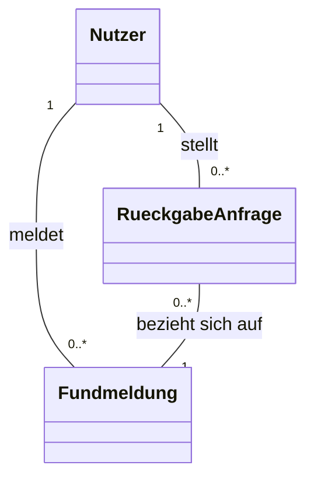
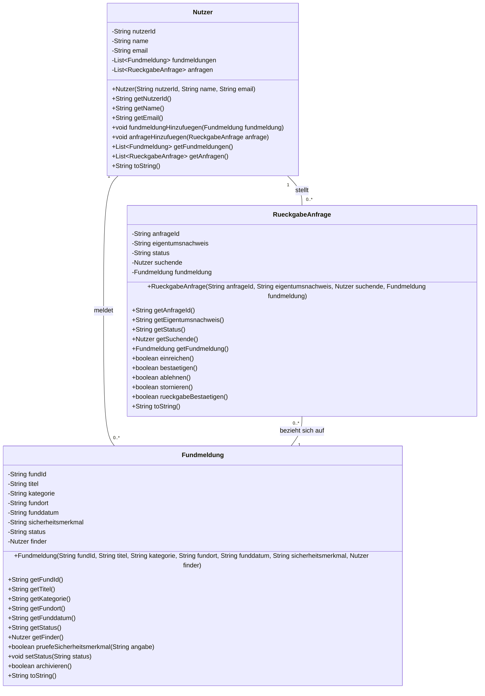

# Übungsblatt 4: UML-Klassendiagramm & Java-Implementierung – „FundPunkt“

## Aufgabe 1 – Einfaches UML-Klassendiagramm

Überführung des Objektdiagramms aus Übungsblatt 3 in ein erstes Klassendiagramm mit den drei zentralen fachlichen Klassen (`Nutzer`, `Fundmeldung`, `RueckgabeAnfrage`), einfachen binären Assoziationen und Multiplizitäten.



### Begründung der Multiplizitäten (Beispiel: `Nutzer` – `Fundmeldung`)
- **Richtung `Nutzer` zu `Fundmeldung` (`0..*`):** Ein registrierter Nutzer kann rein als Suchender angemeldet sein (z. B. Anna Berger) und hat daher `0` eigene Fundmeldungen erfasst. Ein aktiver Finder (z. B. Markus Lindner) kann beliebig viele (`*`) Fundmeldungen anlegen.
- **Richtung `Fundmeldung` zu `Nutzer` (`1`):** Jede Fundmeldung im System muss genau einem (`1`) registrierten Nutzer als Finder zugeordnet sein, damit eindeutig feststeht, wer den Gegenstand verwahrt und eingehende Eigentumsnachweise prüfen darf.

---

## Aufgabe 2 – Detailliertes UML-Klassendiagramm

Erweiterung der ersten Fassung um Attribute (mit Datentypen und Sichtbarkeiten) sowie fachlich sinnvolle Methoden (mit Sichtbarkeiten, Parameterlisten und Rückgabetypen). Bewusst ohne Vererbung, Interfaces oder Entwurfsmuster.



---

## Aufgabe 3 – Bereitstellung als PNG & erster Git-Commit

Das detaillierte Klassendiagramm aus Aufgabe 2 wurde als kompaktes PNG exportiert und im Repository unter `docs/04-klassendiagramm/klassendiagramm.png` abgelegt:


Die Dokumentation und das PNG wurden vor der Java-Implementierung in einem eigenen Commit auf dem Übungsbranch gesichert.

---

## Aufgabe 4 – Implementierung der ersten Java-Klassen & Modellabgleich

Auf Basis von `docs/04-klassendiagramm/klassendiagramm.png` wurden die drei fachlichen Klassen sowie die Startklasse ausschließlich mit der Java-Standardbibliothek (ohne Vererbung oder Frameworks) in `src/` umgesetzt:

- `src/Nutzer.java`
- `src/Fundmeldung.java`
- `src/RueckgabeAnfrage.java`
- `src/Main.java`

### Abgleich zwischen PNG-Klassendiagramm und Java-Code
- **Klassen & Attribute:** Alle modellierten Klassen, privaten Attribute (`-`), Datentypen (`String`, `List<...>`, Klassenreferenzen) und Konstruktoren entsprechen 1:1 dem Klassendiagramm.
- **Multiplizitäten:**
  - `1` zu `0..*` (`Nutzer` – `Fundmeldung` und `Nutzer` – `RueckgabeAnfrage`) ist über `List<Fundmeldung>` bzw. `List<RueckgabeAnfrage>` in `Nutzer` sowie Einzelreferenzen (`finder`, `suchende`) auf der Gegenseite abgebildet.
  - `0..*` zu `1` (`RueckgabeAnfrage` – `Fundmeldung`) ist über die Referenz `fundmeldung` in `RueckgabeAnfrage` realisiert.
- **Methoden & Sichtbarkeiten:** Alle öffentlichen (`+`) Methoden, Parameterlisten und Rückgabetypen (`void`, `boolean`, `String`, `List<...>`) stimmen exakt mit dem Diagramm überein. Das `sicherheitsmerkmal` wird gemäß `N-020` nicht in `toString()` ausgegeben.

---

## Aufgabe 5 – Starten, Testen und Erklären der Java-Anwendung

### 1. Ausführung im Terminal
```bash
javac src/*.java
java -cp src Main
```

### 2. Geprüfte Abläufe & Konsolenausgabe
In `src/Main.java` werden mehrere Objekte erzeugt (`anna`, `markus`, `rucksack`, `anfrage101`, `flasche`, `selbstAnfrage`), die modellierten Beziehungen hergestellt und sowohl der **normale Ablauf (UC-01)** als auch zwei **Rand-/Fehlerfälle** (Stornierung nach Abschluss & Selbst-Beanspruchung) getestet:

```text
=== FundPunkt Demo: Normaler Ablauf (UC-01) ===
Angelegte Fundmeldung: Fundmeldung{fundId='F-10', titel='Blauer Rucksack', kategorie='Taschen', fundort='R-Bau Hoersaal R1.046', status='GEMELDET', finder=Markus Lindner}
Anfrage eingereicht? true -> RueckgabeAnfrage{anfrageId='A-101', status='ANGEFRAGT', suchende=Anna Berger, fundmeldung=Blauer Rucksack}
Fundstatus nach Anfrage: BEANSPRUCHT
Eigentumsnachweis gueltig? true
Nach Bestaetigung:     RueckgabeAnfrage{anfrageId='A-101', status='BESTAETIGT', suchende=Anna Berger, fundmeldung=Blauer Rucksack}
Fundstatus jetzt:      ABHOLBEREIT
Rueckgabe erfasst?     true -> ZURUECKGEGEBEN
Stornierung nach Rueckgabe moeglich? false (erwartet: false)

=== Fehlerfall: Selbst-Beanspruchung (Review-Erkenntnis aus Uebung 3) ===
Selbst-Beanspruchung erlaubt? false (erwartet: false)
```

### 3. Erklärung der Objektbeziehungen, Methoden und Modelltreue
- **Wie die Objekte verbunden sind:**
  - Beim Erzeugen von `rucksack` (`Fundmeldung`) wird `markus` (`Nutzer`) als `finder` übergeben; der Konstruktor trägt die Fundmeldung automatisch auch in `markus.fundmeldungen` ein (bidirektionale Verknüpfung).
  - Beim Erzeugen von `anfrage101` (`RueckgabeAnfrage`) werden `anna` als `suchende` und `rucksack` als `fundmeldung` verknüpft; `anfrage101` wird gleichzeitig in `anna.anfragen` registriert.
- **Was die Methoden bewirken:**
  - `einreichen()` prüft, ob die Fundmeldung noch `GEMELDET` ist, der Eigentumsnachweis nicht leer ist und Suchende ungleich Finder sind. Bei Erfolg wechselt die Anfrage auf `ANGEFRAGT` und die Fundmeldung auf `BEANSPRUCHT`.
  - `pruefeSicherheitsmerkmal(...)` vergleicht die Angabe der Suchenden mit dem verdeckten Sicherheitsmerkmal der Fundmeldung.
  - `bestaetigen()` setzt die Anfrage auf `BESTAETIGT` und die Fundmeldung auf `ABHOLBEREIT`.
  - `rueckgabeBestaetigen()` schließt den Vorgang ab (`ABGESCHLOSSEN` bzw. `ZURUECKGEGEBEN`).
  - `stornieren()` gibt im erlaubten Zustand die Fundmeldung wieder auf `GEMELDET` frei und liefert nach abgeschlossener Rückgabe korrekt `false` zurück.
- **Übereinstimmung mit dem Klassendiagramm:** Alle genutzten Klassen, Attribute, Beziehungen und Methoden in `src/` entsprechen vollständig dem in `docs/04-klassendiagramm/klassendiagramm.png` modellierten Entwurf.

---

### Git-Abgabe (zweiter Commit & Pull Request)
Der Java-Code in `src/` wird getrennt vom Modell-Commit gesichert, gepusht und nach Review durch das Teammitglied per Pull Request in `main` zusammengeführt.