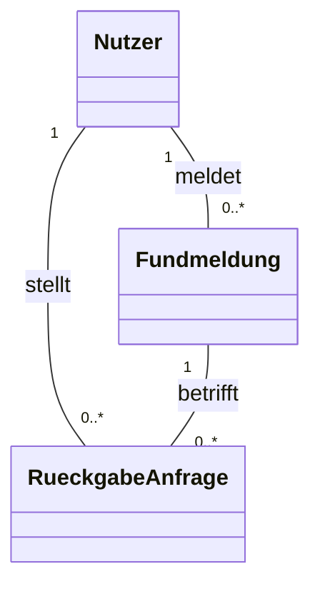
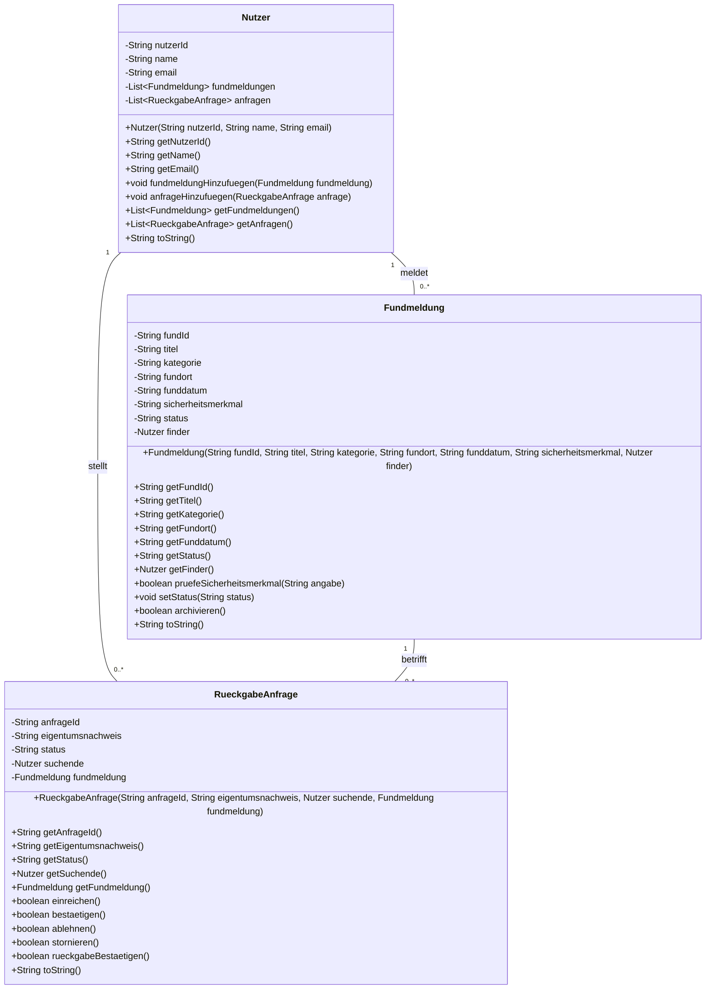
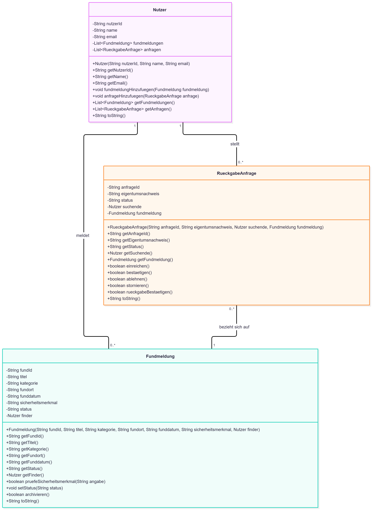

# Übungsblatt 4: UML-Klassendiagramm & Java-Implementierung – Fundbüro-App

---

## Aufgabe 1 - Erstellen Sie ein Klassendiagramm

### Übergang & Design-Entscheidung zu Übungsblatt 3

Aus den in Übungsblatt 3 identifizierten Domänenobjekten (`Nutzer`, `Verlustmeldung`, `Fundmeldung`, `Fundsache`, `Treffer`, `Kontrollfrage`, `Abholtermin`, `Vollmacht`, `Herausgabe`) wird für den ersten lauffähigen Java-Prototyp (Vorgabe: 3–4 fachliche Klassen) bewusst der zentrale Teilprozess **Fundmeldung erfassen, Eigentum prüfen und Rückgabe abwickeln** (`F-030`, `F-060`, `F-080`, `F-090`) herausgegriffen und kompakt modelliert:

- **`Nutzer`** wird unverändert aus Übungsblatt 3 übernommen (ein Nutzer kann je nach Vorgang Finder oder Verlierer/Suchender sein).
- **`Fundmeldung`** bündelt für diese erste Ausbaustufe die gemeldeten Angaben mit den Verwaltungsattributen der physischen `Fundsache` (`status` und das nicht öffentliche `sicherheitsmerkmal` für die Kontrollfrage nach `F-060`).
- **`RueckgabeAnfrage`** bildet den Anspruch eines Verlierers („Das ist meiner“ aus `UC-02`, Schritt 9–11) inklusive Eigentumsnachweis (`Kontrollfrage`) und Statusverlauf bis zur bestätigten Rückgabe ab.
- Weitere Objekte aus Übungsblatt 3 (`Verlustmeldung`, `Treffer`, `Abholtermin`, `Vollmacht`) sind als Erweiterung für die nächsten Ausbaustufen vorgesehen.



### Begründung der Multiplizitäten (Beispiel: `Fundmeldung` – `RueckgabeAnfrage`)

- **Richtung `Fundmeldung` zu `RueckgabeAnfrage` (`0..*`):** Direkt nach dem Anlegen einer Fundmeldung hat noch niemand den Gegenstand beansprucht (`0` Anfragen). Im weiteren Verlauf können mehrere Personen eine Rückgabeanfrage zu derselben Fundsache stellen (`*`, z. B. wenn eine erste Anfrage abgelehnt oder storniert wird oder mehrere Personen denselben Fund beanspruchen).
- **Richtung `RueckgabeAnfrage` zu `Fundmeldung` (`1`):** Jede Rückgabeanfrage bezieht sich immer auf genau eine (`1`) konkrete Fundmeldung und kann nicht ohne sie existieren.

---

## Aufgabe 2 - Detaillieren Sie Ihr Klassendiagramm

Erweiterung der ersten Fassung um Attribute (mit Datentypen und Sichtbarkeiten) sowie fachlich sinnvolle Methoden (mit Sichtbarkeiten, Parameterlisten und Rückgabetypen) – bewusst ohne Vererbung, Interfaces oder Entwurfsmuster.



---

## Aufgabe 3 - Stellen Sie Ihr Klassendiagramm als PNG bereit

Das detaillierte Klassendiagramm aus Aufgabe 2 wurde als kompaktes PNG exportiert und im Repository unter `docs/04-klassendiagramm/klassendiagramm.png` abgelegt:



Dokumentation und PNG wurden vor der Java-Implementierung in einem eigenen Commit auf dem Übungsbranch gesichert.

---

## Aufgabe 4 - Implementieren Sie erste Java-Klassen mit Copilot

Auf Basis von `docs/04-klassendiagramm/klassendiagramm.png` wurden die drei fachlichen Klassen sowie `Main.java` ausschließlich mit der Java-Standardbibliothek (ohne Vererbung oder Frameworks) in `src/` umgesetzt:

- `src/Nutzer.java`
- `src/Fundmeldung.java`
- `src/RueckgabeAnfrage.java`
- `src/Main.java`

### Abgleich von Code und Klassendiagramm

- **Klassen & Attribute:** Alle drei modellierten Klassen, Sichtbarkeiten (`private` für Attribute, `public` für Methoden) und Datentypen stimmen 1:1 mit dem PNG überein.
- **Assoziationen & Multiplizitäten:** `Nutzer` verwaltet `List<Fundmeldung>` und `List<RueckgabeAnfrage>` (`0..*`), während `Fundmeldung` genau einen `finder` (`1`) und `RueckgabeAnfrage` genau eine `suchende` Person (`1`) sowie genau eine `fundmeldung` (`1`) referenziert.
- **Methoden & Fachlogik:** Die Methode `pruefeSicherheitsmerkmal(String angabe)` prüft den Eigentumsnachweis (nicht öffentliches Merkmal gemäß `F-060`), und die Statusmethoden von `RueckgabeAnfrage` (`einreichen()`, `bestaetigen()`, `ablehnen()`, `stornieren()`, `rueckgabeBestaetigen()`) steuern die erlaubten Zustandsübergänge beider Objekte konsistent.

---

## Aufgabe 5 - Starten, testen und erklären Sie Ihre Java-Anwendung

### 1. Ausführung im Terminal

```bash
javac src/*.java
java -cp src Main
```

### 2. Geprüfte Abläufe und Ausgaben

```text
=== Fundbuero-App Demo: Normaler Ablauf (Lena & Tom) ===
Angelegte Fundmeldung: Fundmeldung{fundId='F-10', titel='Schwarzer Rucksack (Eastpak)', kategorie='Tasche/Rucksack', fundort='Endhaltestelle S-Bahn S3 (GPS)', status='GEMELDET', finder=Tom Weber}
Anfrage eingereicht? true -> RueckgabeAnfrage{anfrageId='A-101', status='ANGEFRAGT', suchende=Lena Hoffmann, fundmeldung=Schwarzer Rucksack (Eastpak)}
Fundstatus nach Anfrage: BEANSPRUCHT
Eigentumsnachweis gueltig? true
Nach Bestaetigung: RueckgabeAnfrage{anfrageId='A-101', status='BESTAETIGT', suchende=Lena Hoffmann, fundmeldung=Schwarzer Rucksack (Eastpak)}
Fundstatus jetzt:  ABHOLBEREIT
Rueckgabe erfasst? true -> ZURUECKGEGEBEN
Stornierung nach Rueckgabe moeglich? false (erwartet: false)

=== Fehlerfall: Selbst-Beanspruchung ===
Selbst-Beanspruchung erlaubt? false (erwartet: false)
```

### 3. Erklärung der Objektbeziehungen und Methoden

1. **Objektverknüpfung:** Im Konstruktor von `Fundmeldung` bzw. `RueckgabeAnfrage` wird das neue Objekt automatisch beim jeweiligen `Nutzer` (`Tom Weber` als Finder bzw. `Lena Hoffmann` als Suchende) in die zugehörige Liste eingetragen. `RueckgabeAnfrage` verknüpft dabei die suchende Person mit der konkreten `Fundmeldung`.
2. **Normalablauf & Zustandsübergänge:** Beim Aufruf von `einreichen()` wechselt die Anfrage von `ENTWURF` auf `ANGEFRAGT` und die Fundmeldung auf `BEANSPRUCHT`. Nach erfolgreicher Prüfung über `pruefeSicherheitsmerkmal(...)` setzt `bestaetigen()` die Fundmeldung auf `ABHOLBEREIT`. Mit `rueckgabeBestaetigen()` wird der Vorgang abgeschlossen (`ABGESCHLOSSEN` / `ZURUECKGEGEBEN`).
3. **Fehler- und Randfälle:** Eine Stornierung nach bereits erfolgter Rückgabe (`stornieren()`) wird abgelehnt (`false`). Ebenso verhindert `einreichen()`, dass ein Finder seinen eigenen Fund beansprucht (`suchende.equals(fundmeldung.getFinder())` liefert `false`).
