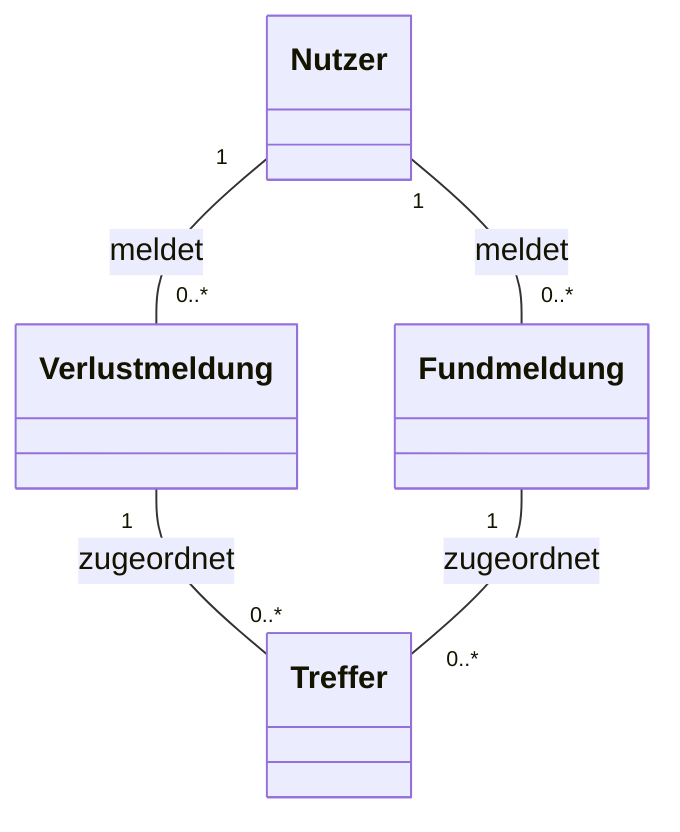
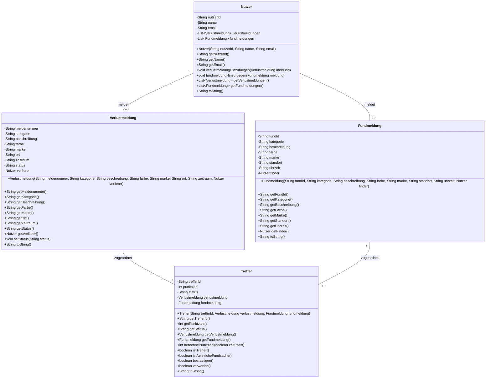

# Übungsblatt 4: UML-Klassendiagramm & Java-Implementierung – Fundbüro-App

---

## Aufgabe 1 - Erstellen Sie ein Klassendiagramm

Überführung des Objektdiagramms aus Übungsblatt 3 in ein einfaches UML-Klassendiagramm mit den vier zentralen fachlichen Klassen (`Nutzer`, `Verlustmeldung`, `Fundmeldung`, `Treffer`), einfachen binären Assoziationen und Multiplizitäten.



### Begründung der Multiplizitäten (Beispiel: `Verlustmeldung` – `Treffer`)

- **Richtung `Verlustmeldung` zu `Treffer` (`0..*`):** Direkt nach dem Absenden einer Verlustmeldung liegt möglicherweise noch kein passender Fund vor (`0` Treffer, wie bei Lena um 18:30 Uhr). Später können mehrere ähnliche Fundmeldungen gefunden und abgeglichen werden (`*`).
- **Richtung `Treffer` zu `Verlustmeldung` (`1`):** Ein Treffer entsteht erst beim Abgleich zwischen einer konkreten Verlustmeldung und einer konkreten Fundmeldung und gehört daher immer zu genau einer (`1`) Verlustmeldung.

---

## Aufgabe 2 - Detaillieren Sie Ihr Klassendiagramm

Erweiterung der ersten Fassung um Attribute (mit Datentypen und Sichtbarkeiten) sowie fachlich sinnvolle Methoden (mit Sichtbarkeiten, Parameterlisten und Rückgabetypen) – bewusst ohne Vererbung, Interfaces oder Entwurfsmuster.



---

## Aufgabe 3 - Stellen Sie Ihr Klassendiagramm als PNG bereit

Das detaillierte Klassendiagramm aus Aufgabe 2 wurde als kompaktes PNG exportiert und im Repository unter `docs/04-klassendiagramm/klassendiagramm.png` abgelegt:


Dokumentation und PNG wurden vor der Java-Implementierung in einem eigenen Commit auf dem Übungsbranch gesichert.

---

## Aufgabe 4 - Implementieren Sie erste Java-Klassen mit Copilot

Auf Basis von `docs/04-klassendiagramm/klassendiagramm.png` wurden die fachlichen Klassen sowie `Main.java` ausschließlich mit der Java-Standardbibliothek (ohne Vererbung oder Frameworks) in `src/` umgesetzt:

- `src/Nutzer.java`
- `src/Verlustmeldung.java`
- `src/Fundmeldung.java`
- `src/Treffer.java`
- `src/Main.java`

### Abgleich von Code und Klassendiagramm

- **Klassen & Attribute:** Alle vier modellierten Klassen, Sichtbarkeiten (`private` für Attribute, `public` für Methoden) und Datentypen stimmen 1:1 mit dem PNG überein.
- **Assoziationen & Multiplizitäten:** `Nutzer` verwaltet `List<Verlustmeldung>` und `List<Fundmeldung>` (`0..*`), während `Verlustmeldung` genau einen `verlierer` (`1`), `Fundmeldung` genau einen `finder` (`1`) und `Treffer` genau eine `verlustmeldung` (`1`) sowie eine `fundmeldung` (`1`) referenziert.
- **Methoden:** `berechnePunktzahl(boolean zeitPasst)` bildet das in Übung 3 definierte Punktesystem (`F-040`: Kategorie Pflicht, Ort 30, Zeit 30, Farbe 20, Marke 20; Treffer ab 70, ähnlich ab 50) direkt im Code ab.

---

## Aufgabe 5 - Starten, testen und erklären Sie Ihre Java-Anwendung

### 1. Ausführung im Terminal

```bash
javac src/*.java
java -cp src Main
```

### 2. Geprüfte Abläufe und Ausgaben

```text
=== Fundbuero-App Demo: Szenario Lena & Tom (100 Punkte) ===
Verlustmeldung: Verlustmeldung{meldenummer='V-01', kategorie='Tasche/Rucksack', farbe='schwarz', marke='Eastpak', status='Offen', verlierer=Lena Hoffmann}
Fundmeldung:    Fundmeldung{fundId='F-01', kategorie='Tasche/Rucksack', farbe='schwarz', marke='Eastpak', standort='Endhaltestelle S-Bahn (GPS)', finder=Tom Weber}
Berechnete Punktzahl: 100
Ist Treffer (>= 70)? true
Status der Verlustmeldung nach Treffer: Treffer zugeordnet
Treffer bestaetigt? true -> Treffer{trefferId='T-01', punktzahl=100, status='Bestaetigt', verlust='V-01', fund='F-01'}
Status der Verlustmeldung nach Bestaetigung: Reserviert

=== Randfall 1: Abweichende Kategorie (F-040 Akzeptanzkriterium 2) ===
Punktzahl bei Schluessel vs. Rucksack: 0 (Treffer: false)

=== Randfall 2: 60 Punkte -> nur aehnliche Fundsache (F-040 Akzeptanzkriterium 4) ===
Punktzahl: 60 | Treffer: false | Aehnliche Fundsache: true
```

### 3. Erklärung der Objektbeziehungen und Methoden

1. **Objektverknüpfung:** Im Konstruktor von `Verlustmeldung` bzw. `Fundmeldung` wird das jeweilige Objekt automatisch beim übergebenen `Nutzer` (`Lena Hoffmann` bzw. `Tom Weber`) in die entsprechende Liste eingetragen. `Treffer` verbindet anschließend beide Meldungen.
2. **Punkteberechnung (`berechnePunktzahl`):** Stimmen die Kategorien nicht überein, werden sofort `0` Punkte vergeben (Randfall 1). Bei gleicher Kategorie werden Ort (30), Zeit (30), Farbe (20) und Marke (20) addiert. Ab 70 Punkten setzt das System den Status der Verlustmeldung automatisch auf `"Treffer zugeordnet"`.
3. **Statusübergänge (`bestaetigen` / `verwerfen`):** Bestätigt Lena den Treffer nach Eigentumsnachweis und Terminbuchung, wechselt der Status von `Verlustmeldung` auf `"Reserviert"`. Bei 60 Punkten (Randfall 2) gilt `istTreffer() == false`, aber `istAehnlicheFundsache() == true`.
